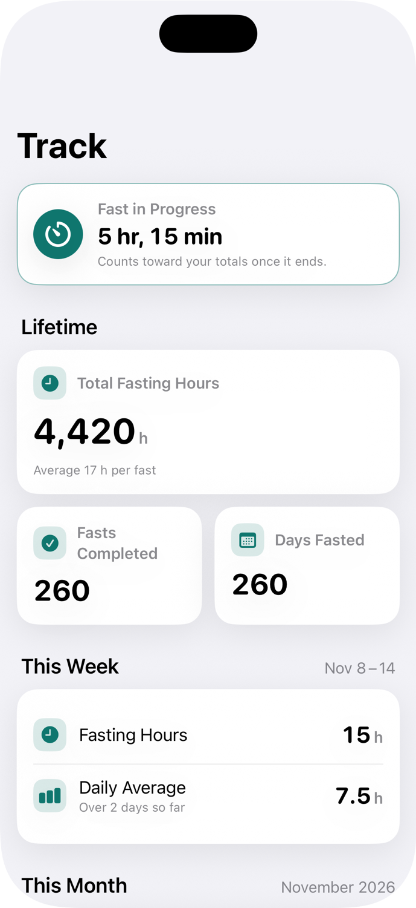
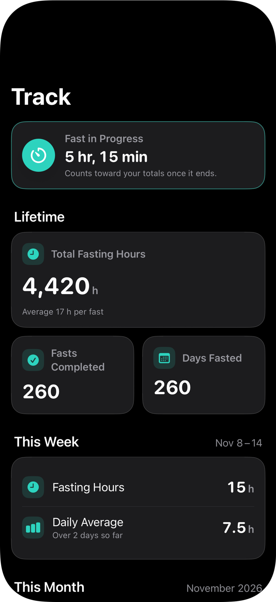
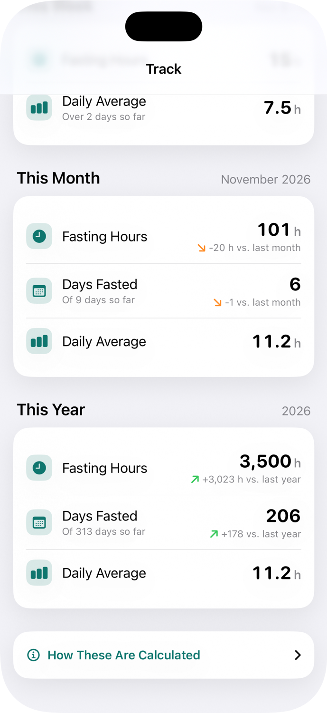
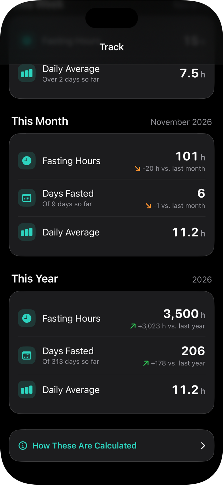
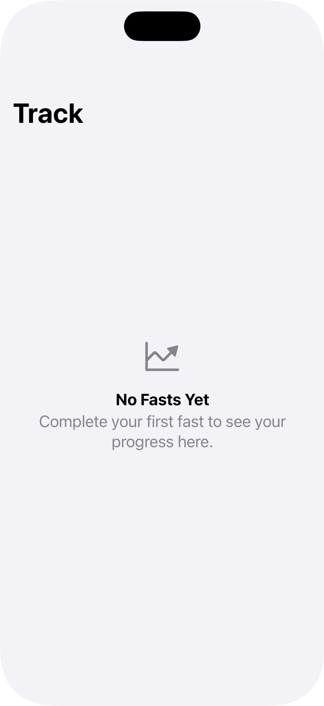

# Track Tab Metrics

This document defines every number on the Track tab and the time ranges it covers.
The logic lives in `Intermit/Models/TrackMetrics.swift`. The layout is in
`Intermit/Features/Track/`.

## Core rule: a fast belongs to the day it ends

Each **completed** fast is assigned to the local calendar day on which it ended.
All of its hours count toward that day, and toward the week, month, and year that
contain that day. Fasts are never split across days or periods.

This is what keeps the numbers consistent:

- An overnight fast (8 PM to noon the next day) is **one** day fasted, not two.
- This month's totals are always part of this year's, which are always part of the lifetime totals.
- Hours and days for a period always describe the same set of fasts.

The trade-off is that a fast ending at 12:30 AM on December 1 counts entirely toward
December, even though most of it happened in November.

## Definitions

| Metric | Definition |
| --- | --- |
| Fasts completed | Number of fasts that have an end time. |
| Fasting hours | Sum of `end − start` for those fasts, in hours. Totals are rounded to whole hours for display. |
| Days fasted | Number of distinct local calendar days on which at least one fast ended. Two fasts ending on the same day count as one day. |
| Daily average | Fasting hours in the period ÷ calendar days so far in the period, **including today**. Shown with one decimal place. |
| Average per fast (lifetime) | Lifetime fasting hours ÷ fasts completed. |
| Fast in progress | The most recently started fast with no end time. It is shown separately with its elapsed time and is **not** included in any total until it ends. |

## Time boundaries

All boundaries come from the SwiftUI environment's `Calendar`, so they follow the
user's current locale, calendar, and time zone, and update if those change.

| Period | Range |
| --- | --- |
| This week | `calendar.dateInterval(of: .weekOfYear, for: now)`. The first weekday follows the locale (Sunday in the US, Monday in much of Europe). |
| This month | From the first day of the current month through its end. |
| This year | From January 1 of the current year through its end. |
| Lifetime | All completed fasts. |

Days are computed with `calendar.startOfDay(for:)`. A fast's day is determined by
the time zone in effect **when the stats are shown**, so if someone travels across
time zones, a fast near midnight can move to the neighboring day. Storing a time
zone with each fast would fix this; it isn't needed yet.

The screen refreshes once a minute, so the in-progress timer and "today" stay
current, including across midnight and the start of a new month or year.

## Trends

Trends compare a partial period with the **same stretch** of the previous period,
so the start of a month isn't compared with a whole previous month.

- **Month:** from the first of this month up to now, compared with the first of last month up to the same moment one month ago. For example, Nov 1–9 compares with Oct 1–9. `Calendar.date(byAdding:)` clamps to shorter months, so March 31 compares with Feb 1–28 (or 29).
- **Year:** from Jan 1 up to now, compared with Jan 1 up to the same moment last year.

Trends are shown for fasting hours and days fasted. The change is shown as an
absolute difference (e.g. "+6 h vs. last month") rather than a percentage, because a
percentage can't be calculated when the previous period is zero.

- When both values are zero, no trend is shown.
- A difference that rounds to zero is shown as "Same as last month".
- Direction is conveyed by an arrow and a +/− sign, not only by color (green for up, orange for down).

## Edge cases

| Situation | Behavior |
| --- | --- |
| Still loading | The full layout is shown with placeholder redaction (a skeleton). VoiceOver reads "Loading your stats". |
| No fasts at all | An empty state: "No Fasts Yet". |
| Only a fast in progress | The in-progress card is shown with zero totals. |
| Partial week, month, or year | Daily averages divide by the days so far; trends compare equal-length stretches. |
| A fast's end is before its start (bad data) | It still counts as a fast and a day, with zero hours. |

## Accessibility

- All text uses Dynamic Type text styles. Icon sizes scale with `@ScaledMetric`.
- At accessibility text sizes, the half-width lifetime cards stack vertically, and each row moves its value below its label.
- Each metric is a single VoiceOver element with a full label and value, for example "Fasting hours this month, 42 hours, up 6 hours compared with last month".
- Section titles are marked as headers for VoiceOver's rotor.
- Body text uses system primary and secondary colors, so it keeps adequate contrast in light, dark, and Increased Contrast modes.

## Data source

The app doesn't save fasts yet. `TrackView` takes a `loadSessions` closure that
currently returns `FastingSession.samples()`, about 14 months of made-up history plus
one fast in progress. Replace it with the real store once fasts are saved.

## Screenshots

| | Light | Dark |
| --- | --- | --- |
| Top |  |  |
| Bottom |  |  |

| Loading | No fasts |
| --- | --- |
|  |  |
